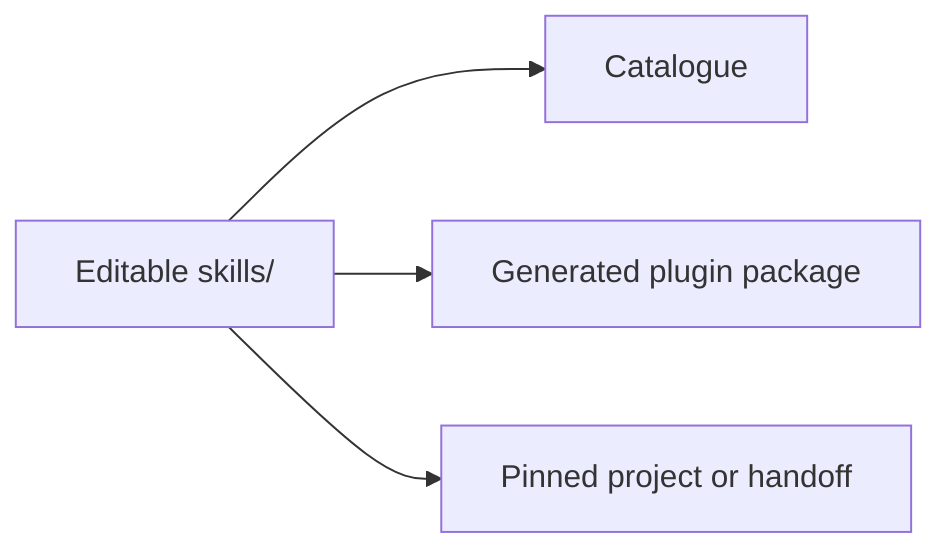

# odskills

Open, reusable agent skills for software development, mathematics, Lean and
skill engineering. Each skill is an experimental, portable `SKILL.md` package.
Browse the [catalogue](catalogue/skills.md) and choose the skill that fits the
outcome you want.

| Area | Examples |
| --- | --- |
| Development | Plan work, debug, review changes, verify releases and diagnose bottlenecks. |
| Mathematics and Lean | Find invariants, attack claims, audit evidence, write proofs and diagnose checker cost. |
| Skill engineering | Author and test reusable skills. |



## Use one pinned skill

Check out a reviewed commit or [release tag](https://github.com/CheyLoveday/odskills-public/releases).
For the full bundle, use the [plugin marketplace](docs/install.md#install-the-codex-plugin).
The [installation guide](docs/install.md) also covers the GitHub installer,
verification and rollback.
For an explicit handoff, including Open Math OS, give the agent that pin and the
path to the chosen `SKILL.md`. Make the entire skill folder readable in the task
workspace.

For Codex native discovery, start with an empty destination in the consuming
project. From the odskills checkout, copy one complete package and check its
bytes. This example selects `write-lean-proofs`.

```sh
source_package=skills/mathematics/write-lean-proofs
consumer_skills=/absolute/path/to/consumer/.agents/skills
destination="$consumer_skills/write-lean-proofs"
mkdir -p "$consumer_skills" &&
  mkdir "$destination" &&
  cp -R "$source_package/." "$destination/" &&
  python tools/verify_install.py --source "$source_package" --installed "$destination"
```

Start Codex in that project, look for the skill with `/skills`, and try one task
with a known outcome. Check which instructions were read and the result.
Record the pin and keep the previous verified package outside discovery paths
if you upgrade.

## Contribute

Edit the selected package under `skills/<domain>/<id>/`. See the
[contributor guide](CONTRIBUTING.md) and [agent instructions](AGENTS.md).
GitHub hosts the canonical source for these skills. ChatGPT directory
submission is parked.

[MIT licence](LICENSE) · [Notices](NOTICES.md) · [Support](SUPPORT.md) ·
[Privacy](PRIVACY.md) · [Terms](TERMS.md)
